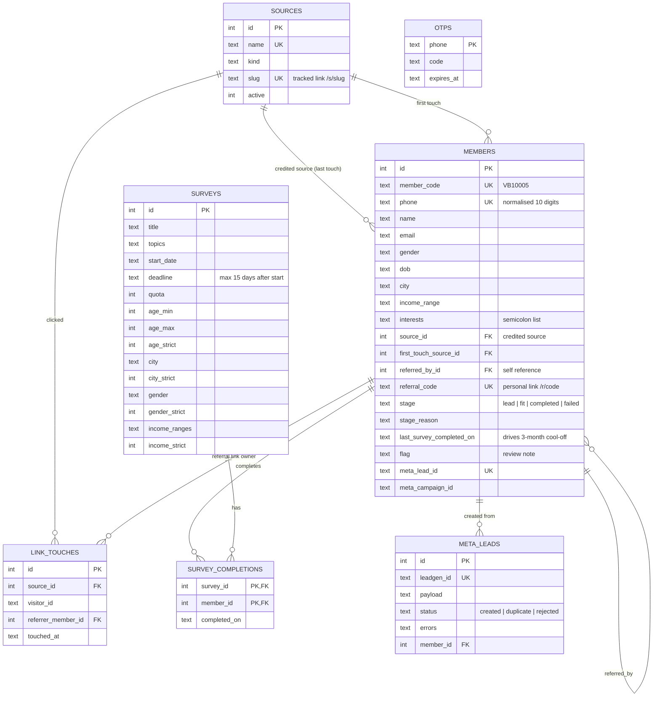

# Database diagram

SQLite for the prototype; the schema is plain SQL (`schema.sql`) and maps directly to PostgreSQL.

## Key modelling decisions

- **Sources are rows, not code.** Adding LinkedIn is one INSERT from the admin screen; the tracked link is `/s/<slug>`.
- **Two attributions on one member:** `source_id` (credited, last touch) and `first_touch_source_id` (kept for analysis). `referred_by_id` is separate, so a channel and a referrer can both be recorded.
- **One funnel stage per member** (`stage`). The source dashboard counts Fit and Completed straight from members; "My Referrals" reads the referred member's stage.
- **Referral = `members.referred_by_id`** (self-reference), so a referral can never exist without both people.
- **Survey rules live on the survey** with a `*_strict` flag each. Eligibility is *computed* on read (never stored), so editing a rule or a member's profile is reflected immediately.
- **Cool-off** needs only `last_survey_completed_on` + 3 months. `survey_completions` provides quota counts.
- **`meta_leads`** keeps every inbound lead, including rejected ones, as a review queue; nothing is silently dropped.
