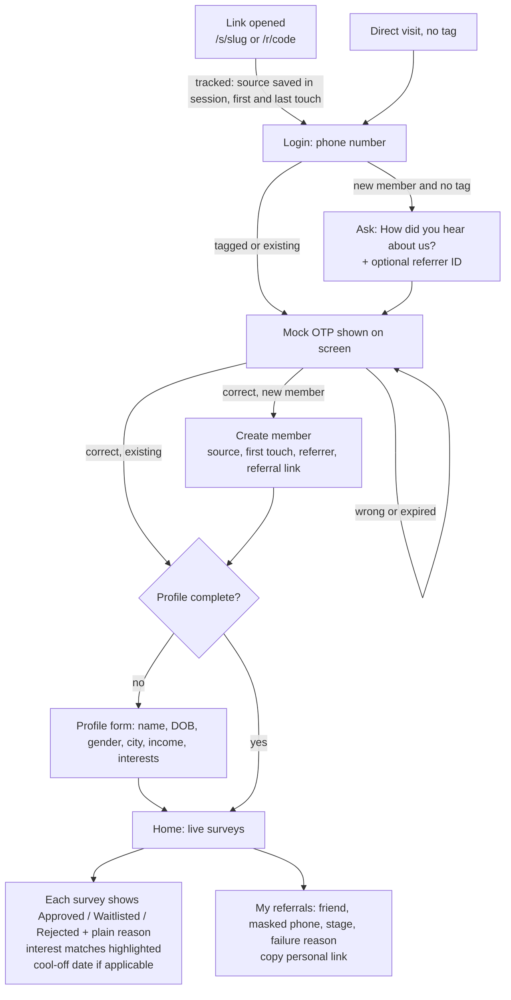
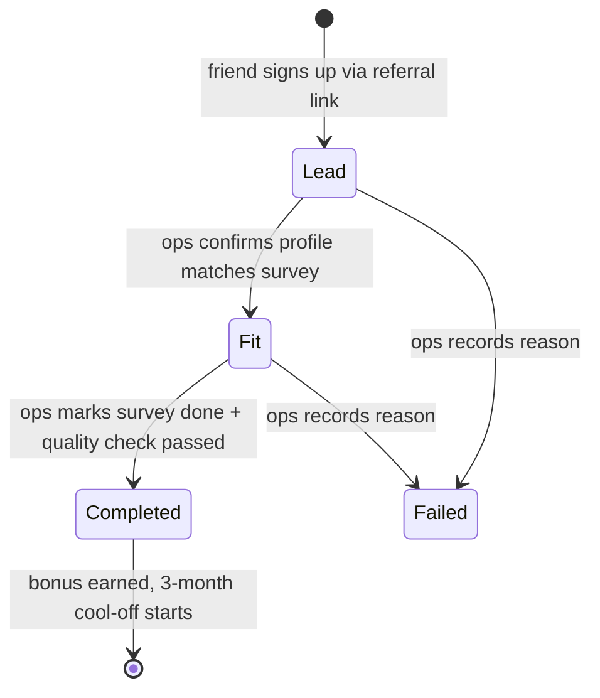
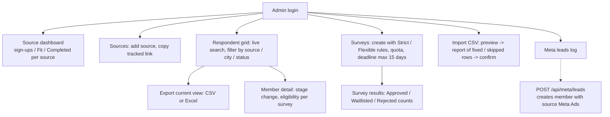

# User flow: ViewBox Panel System

Three journeys: a **new member** joining through a tracked link, a **returning member** checking status, and **ops/admin** running the panel.

## 1. Member sign-up and portal

## 2. Referral lifecycle (ops-driven)

## 3. Admin / ops

## Screens (mobile-first member side)

| Screen | Purpose | Empty / error states |
|---|---|---|
| Login | phone + how-heard + referrer | invalid number, missing how-heard |
| OTP | enter mock code | wrong or expired code |
| Profile | one-time details | per-field validation messages |
| Home | surveys + status + reasons | "No surveys live right now" |
| My referrals | link, friends, stages | "No referrals yet" |
